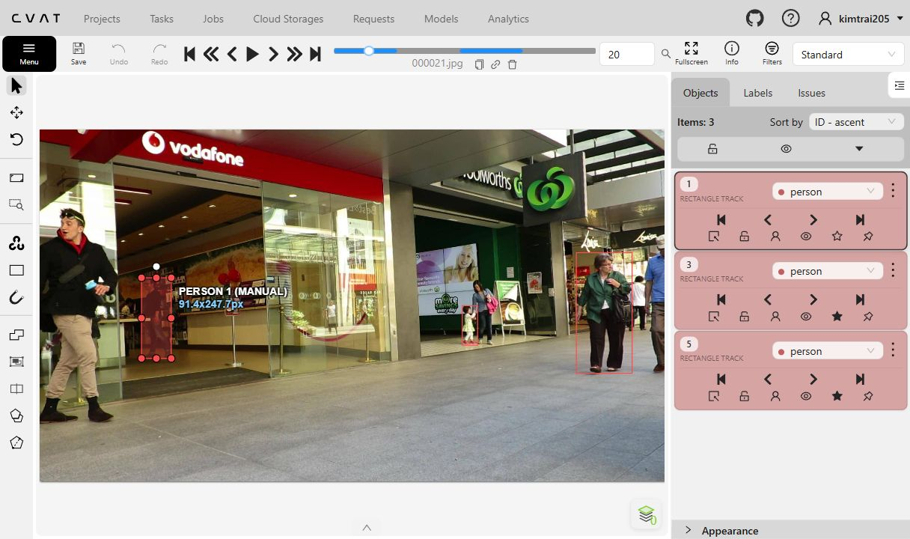
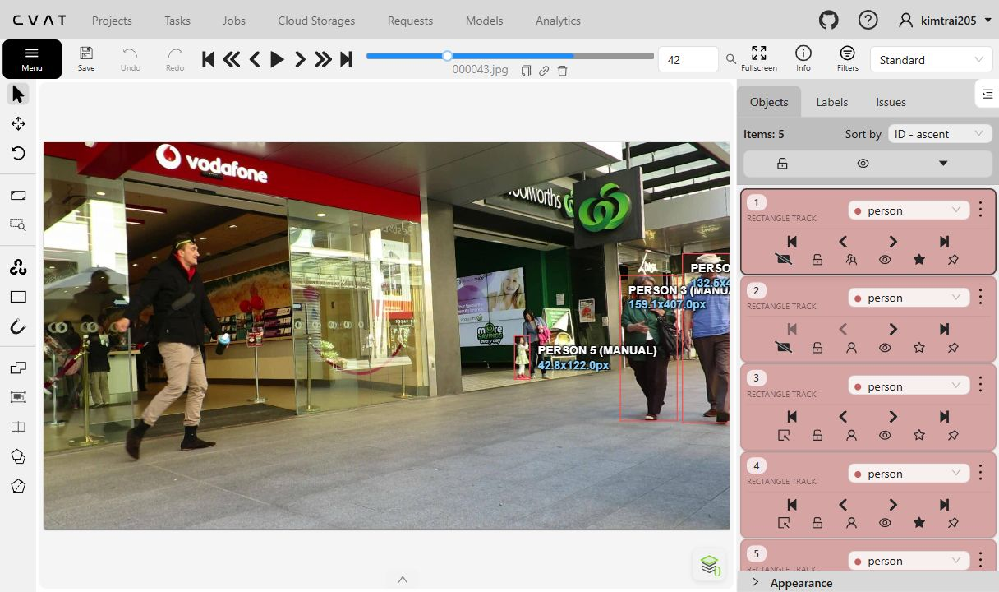
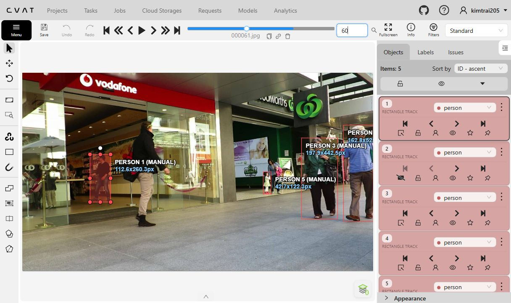

# Báo cáo cá nhân — Bùi Kim Trai — 2A202603176

Dữ liệu: MOT17-09, 150 frame, 1920×1080, 30 fps. Nguồn: MOT17, MOTChallenge (Milan et al., 2016), giấy phép CC BY-NC-SA 3.0. Số frame trong báo cáo theo CVAT: **0–149**; trong MOT TXT là số này cộng 1.

## 0. Thông tin học viên

- Họ tên: **Bùi Kim Trai**.
- MSSV: **2A202603176**.
- Mã đề: **A**, được xác nhận lại bằng script chia đề theo MSSV.
- Email: buikimtrai2k5@gmail.com.
- Repository: [K5-L2A-Day05-BuiKimTrai-2A202603176-MOTTracking](https://github.com/KtraiVla/K5-L2A-Day05-BuiKimTrai-2A202603176-MOTTracking).
- CVAT local: task 17, job 17, `DAY05-MOT17-09-A-2A202603176`.
- Buổi gán nhãn ban đầu theo thời gian tôi nhớ lại: **16:30–19:30 ngày 13/11/2026 (GMT+7)**, tổng **180 phút**. Tôi không đo riêng theo người hoặc checkpoint. Các lượt kiểm tra, tối ưu và hoàn thiện sau buổi không có số phút ghi riêng để cộng thêm.

## 1. Xem trước đoạn video (CP0)

Bảng được bổ sung từ file xuất và lượt rà soát sau khi gán. Tôi không có bảng ghi riêng trước khi vẽ, nên không ghi đây là nhật ký đã lập trước buổi gán. Các frame có mặt được xác định từ nhãn xuất; mô tả chỗ khó là nội dung đối chiếu hỗ trợ, không phải kết quả chấm GT.

Cấu hình được kiểm tra trên job: **Player step = 10**, tự lưu bật, luôn hiện thông tin object bật và hiện cả track đang outside trong panel bật. Task có một job, nhãn `person`, frame 0–149; bản xuất có đúng 5 track và không có shape rời.

| Mã | Frame xuất hiện trong nhãn | Frame cuối có mặt | Rẽ / dừng / đổi tốc độ | Bị che ở frame | Ghi chú |
|---|---:|---:|---|---|---|
| P1 | 0 | 149 | Chưa ghi riêng mốc rẽ/dừng trước khi vẽ | 34–52 theo cờ trong file | Đoạn bị người đi ngang che; rà cờ và tính liên tục của ID. |
| P2 | 61 | 149 | Chưa ghi riêng mốc rẽ/dừng trước khi vẽ | Không có cờ occluded | Xuất hiện từ frame 61; giữ đúng người khi đi trong cửa hàng. |
| P3 | 0 | 149 | Chưa ghi riêng mốc rẽ/dừng trước khi vẽ | Không có cờ occluded | Người áo xanh lá tiến gần camera, kích thước box thay đổi. |
| P4 | 40 | 149 | Chưa ghi riêng mốc rẽ/dừng trước khi vẽ | 43 | Người áo xanh dương xuất hiện ở mép phải, tiến gần camera. |
| P5 | 0 | 146 | Chưa ghi riêng mốc rẽ/dừng trước khi vẽ | 112–134 khuất; 135–136, 144–146 occluded | Người nhỏ ở xa; có đoạn outside 112–134 và kết thúc từ 147. |

## 2. Keyframe và thời gian (CP1, CP4)

Tôi tự gán box và track ID ban đầu, chỉnh gần như từng frame để bám người vì chưa hiểu rõ nội suy. Sau khi được giải thích, tôi nhờ hỗ trợ rà soát và rút gọn các mốc dư; tôi vẫn đang làm quen với cách chọn mốc. Những keyframe giữ lại dùng nguyên tọa độ đã lưu; các box ở giữa được CVAT nội suy lại. Số liệu dưới đây lấy từ bản xuất cuối.

| Mã / ID trên CVAT / ID trong MOT | Số keyframe có mặt | Keyframe tại frame | Số frame có mặt | KF / 100 frame | Thời gian (phút) | Chỗ khó / quan sát hỗ trợ |
|---|---:|---|---:|---:|---|---|
| P1 / ID 1 / MOT ID 1 | 67 | 0, 4, 8, 11–17, 19, 27, 29–35, 39–40, 44, 47–56, 59, 61–64, 66–67, 70, 74, 78, 80, 83, 86–89, 91–92, 96, 99–100, 103, 106, 109–111, 114, 118, 121, 126–127, 134, 141, 143, 149 | 148 | 45.3 | Không đo riêng | Đoạn bị người đi ngang che; rà cờ và tính liên tục của ID. |
| P2 / ID 2 / MOT ID 5 | 40 | 61–64, 66–67, 70–72, 74, 76–79, 81, 86, 89, 91, 94, 96–97, 99, 101–103, 105, 107, 110–111, 115, 120, 123, 125, 127, 130, 136, 140, 144–145, 149 | 89 | 44.9 | Không đo riêng | Xuất hiện từ frame 61; giữ đúng người khi đi trong cửa hàng. |
| P3 / ID 3 / MOT ID 2 | 65 | 0, 12, 16–17, 20, 25–27, 31, 35–36, 40, 43–44, 46–47, 49, 52–55, 57, 61, 63, 70, 72, 75, 79, 81–83, 86, 88–89, 92, 96, 98, 101, 103–106, 110, 114–115, 117, 119–122, 124–127, 129–130, 133–134, 136–137, 140, 144, 146–147, 149 | 150 | 43.3 | Không đo riêng | Người áo xanh lá tiến gần camera, kích thước box thay đổi. |
| P4 / ID 4 / MOT ID 4 | 47 | 40, 42–44, 51, 54, 56, 58–59, 67, 69–70, 74, 76, 78–79, 86, 89, 91, 93–94, 96–98, 101, 103–104, 107, 109–110, 113–114, 118, 124, 126–127, 129–130, 132, 134, 136–138, 141, 144, 147, 149 | 110 | 42.7 | Không đo riêng | Người áo xanh dương xuất hiện ở mép phải, tiến gần camera. |
| P5 / ID 5 / MOT ID 3 | 45 | 0–12, 14–20, 22–25, 29–30, 32–35, 37–38, 40–41, 43, 45, 71, 98, 135, 137, 139–141, 144–145 | 124 | 36.3 | Không đo riêng | Người nhỏ ở xa; có đoạn outside 112–134 và kết thúc từ 147. |
| **Tổng** | **264** | — | **621** | **42.5** | **180 phút cho buổi gán ban đầu; không đo riêng từng người** | — |

Mật độ cả bài = **264 ÷ 621 × 100 = 42,5 keyframe / 100 frame có mặt**. Số 621 là tổng số cặp người–frame, không phải độ dài video; video có 150 frame. P1 hiện có nhiều keyframe nhất (67), gồm các mốc quanh đoạn che và các điều chỉnh chuyển động. Ban đầu tôi chỉnh dày để box bám người; việc rút gọn sau đó có hỗ trợ kỹ thuật, nên tôi không coi toàn bộ các mốc cuối là lựa chọn đã chủ động lên kế hoạch ngay từ đầu.

## 3. Đoạn bị che (CP2)

Người bị che: **P1, ID 1 trên CVAT**, người áo đen trong cửa hàng Vodafone.

| Mốc đọc từ file đang nộp | Frame CVAT |
|---|---:|
| Bắt đầu `occluded` | 34 |
| Bắt đầu `outside` | 42 |
| Hiện lại: tắt `outside`, vẫn `occluded` | 44 |
| Tắt `occluded` | 53 |

- File đang nộp giữ outside ở frame **42–43**, tức **2 frame = 2/30 ≈ 0,067 giây**, dưới ngưỡng 60 frame của lớp.
- Cùng ID 1 được giữ trước và sau đoạn này. MOT ID tương ứng là 1; hai frame outside không có dòng của ID đó trong MOT TXT. Các frame occluded vẫn được xuất.
- Tôi giữ cùng ID vì ở các đoạn che một phần vẫn nhìn được một phần cơ thể và theo dõi hành động của người đó. Tôi dựa vào diễn biến chuyển động để nhận ra người cũ khi hiện lại; tại hai frame khuất hẳn thì không nói là vẫn nhìn thấy người.
- Đối chiếu ảnh trước–sau: người áo đen vẫn ở khu vực trong cửa hàng, ngoại hình phù hợp và sự xuất hiện lại tiếp nối vị trí trước khi khuất. Tôi không đo vận tốc, nên chỉ nhận xét sự tiếp nối chuyển động, không đưa số tốc độ ước đoán vào báo cáo.
- Các mốc trên phản ánh cờ hiện tại của học viên. Ảnh minh chứng và lượt xem trực tiếp dùng để đối chiếu; không coi việc checker không cảnh báo là xác nhận mọi mốc che khuất đã trùng GT.

Ba ảnh dưới đây chụp trực tiếp từ **job 17**, không phải ảnh minh họa tạo lại. Nguồn ảnh: **MOT17, MOTChallenge (Milan et al., 2016)**; giao diện và nhãn là bài làm trên CVAT local.

**Trước đoạn che — frame 20:** P1 đang có box, thấy nhãn PERSON 1 và object ID 1.



**Giữa đoạn che — frame 42:** P1 không có box trên ảnh; object ID 1 vẫn nằm trong panel và cờ outside đang bật.



**Sau khi hiện lại — frame 60:** P1 có box trở lại và vẫn mang ID 1.



## 4. Tự review ID (CP3)

Tôi xác nhận đã tự review đủ hai lượt: lượt 1 theo từng người, đi ngược từ frame 149 về 0; lượt 2 nhìn toàn cảnh theo bước 10 frame. Sau hai lượt, tôi không còn thấy lỗi trong bản hiện tại. Theo ngoại lệ của mẫu báo cáo, tôi ghi một dòng kết quả thay vì tạo ba lỗi không có thật.

| Frame | Mã người | Loại lỗi | Mô tả một câu | Phát hiện ở lượt | Đã sửa? |
|---|---|---|---|---|---|
| 0–149 | P1–P5 | — (không có lỗi còn phát hiện) | Đã kiểm hai lượt, không còn thấy lỗi trong bản hiện tại. | Cả hai lượt | Không có lỗi còn phát hiện để ghi sửa thêm |

**Tổng hợp lỗi còn phát hiện sau tự review:**

| `id_switch` | `fragmentation` | `lost` | `merge` | `false_track` | `drift` | `flag` |
|---:|---:|---:|---:|---:|---:|---:|
| 0 | 0 | 0 | 0 | 0 | 0 | 0 |

Các số 0 là kết quả quan sát và xác nhận của tôi ở lượt tự review cuối, không phải bộ đếm lỗi chấm bằng GT. Trước đó tôi từng thấy một vài frame box chưa bám sát người, nhưng không ghi lại mã người, frame và số lần; tôi không suy ra rằng lịch sử bài chưa từng có lỗi. Với câu hỏi lỗi nào chỉ lượt 2 mới thấy: tôi không có nhật ký phân biệt hai lượt nên không kết luận hoặc tự tạo một ví dụ đã xảy ra.

Kết quả kiểm tra kỹ thuật có hỗ trợ: đúng 5 track, 621 box; các mốc vị trí tham chiếu của P1–P5 khớp các track tương ứng. Kết quả này không tự xác nhận vị trí box đúng trên mọi frame và không phải phép chấm GT. Không lấy việc giảm mật độ keyframe làm một lỗi `flag` hoặc tự tạo thêm lỗi ID cho đủ dòng.

## 5. File xuất và kết quả tự kiểm (CP4)

| Kiểm tra | Kết quả |
|---|---|
| File MOT 1.1 | `src/exports/BuiKimTrai_mot.zip`, chứa `gt/gt.txt` và `gt/labels.txt` |
| File CVAT for video 1.1 | `src/exports/BuiKimTrai_cvat_video.zip`, chứa `annotations.xml` |
| Save images | Không kèm ảnh hoặc video trong hai ZIP |
| Số track ID / tổng số box có mặt | 5 / 621 |
| Outside có dòng trong MOT TXT? | Không; đã đối chiếu toàn bộ các frame có mặt giữa hai định dạng |
| Hai định dạng khớp tọa độ? | Có, sau tính kích thước box và sai số làm tròn |
| Job 17 | Completed tại lần rà soát |
| MOTA / IDF1 | Không tính; script học viên không có GT |

Lệnh chạy từ thư mục gốc repo:

```powershell
python src/check_submission.py --mot src/exports/BuiKimTrai_mot.zip --cvat src/exports/BuiKimTrai_cvat_video.zip
```

```text
Số frame in theo CVAT (bắt đầu từ 0). Trong gt.txt, frame_id = frame CVAT + 1.

=== File MOT 1.1: BuiKimTrai_mot.zip ===
  Số track ID: 5   |   Tổng số box: 621
  [OK]        Đúng 5 track ID.

  Track | Frame có mặt | Số frame | Đoạn vắng (outside)
      1 |   0–149      |      148 | 42–43
      2 |   0–149      |      150 | -
      3 |   0–146      |      124 | 112–134
      4 |  40–149      |      110 | -
      5 |  61–149      |       89 | -


=== File CVAT for video 1.1: BuiKimTrai_cvat_video.zip ===

  Track | Nhãn   | Frame thấy | Keyframe | KF/100 frame | Frame occluded | Lần bật outside
      0 | person |        148 |       67 |         45.3 |             17 |               1
              Track 0: keyframe ở frame [0, 4, 8, 11, 12, 13, 14, 15, 16, 17, 19, 27, 29, 30, 31, 32, 33, 34, 35, 39, 40, 44, 47, 48, 49, 50, 51, 52, 53, 54, 55, 56, 59, 61, 62, 63, 64, 66, 67, 70, 74, 78, 80, 83, 86, 87, 88, 89, 91, 92, 96, 99, 100, 103, 106, 109, 110, 111, 114, 118, 121, 126, 127, 134, 141, 143, 149]
      1 | person |         89 |       40 |         44.9 |              0 |               0
              Track 1: keyframe ở frame [61, 62, 63, 64, 66, 67, 70, 71, 72, 74, 76, 77, 78, 79, 81, 86, 89, 91, 94, 96, 97, 99, 101, 102, 103, 105, 107, 110, 111, 115, 120, 123, 125, 127, 130, 136, 140, 144, 145, 149]
      2 | person |        150 |       65 |         43.3 |              0 |               0
              Track 2: keyframe ở frame [0, 12, 16, 17, 20, 25, 26, 27, 31, 35, 36, 40, 43, 44, 46, 47, 49, 52, 53, 54, 55, 57, 61, 63, 70, 72, 75, 79, 81, 82, 83, 86, 88, 89, 92, 96, 98, 101, 103, 104, 105, 106, 110, 114, 115, 117, 119, 120, 121, 122, 124, 125, 126, 127, 129, 130, 133, 134, 136, 137, 140, 144, 146, 147, 149]
      3 | person |        110 |       47 |         42.7 |              1 |               0
              Track 3: keyframe ở frame [40, 42, 43, 44, 51, 54, 56, 58, 59, 67, 69, 70, 74, 76, 78, 79, 86, 89, 91, 93, 94, 96, 97, 98, 101, 103, 104, 107, 109, 110, 113, 114, 118, 124, 126, 127, 129, 130, 132, 134, 136, 137, 138, 141, 144, 147, 149]
      4 | person |        124 |       45 |         36.3 |              5 |               2
              Track 4: keyframe ở frame [0, 1, 2, 3, 4, 5, 6, 7, 8, 9, 10, 11, 12, 14, 15, 16, 17, 18, 19, 20, 22, 23, 24, 25, 29, 30, 32, 33, 34, 35, 37, 38, 40, 41, 43, 45, 71, 98, 135, 137, 139, 140, 141, 144, 145]

  Tổng: 264 keyframe / 621 frame có mặt = 42.5 keyframe / 100 frame
  [OK]        Đọc được 5 track từ annotations.xml.

=== Tóm tắt ===
  Lỗi: 0   |   Cảnh báo: 0
  Đạt. Dán phần tóm tắt này vào báo cáo mục 5.
```

Kết quả: **0 lỗi, 0 cảnh báo**. Không còn cảnh báo mật độ keyframe trên 50/100 frame. Đây là kết quả tự kiểm kỹ thuật; điểm vị trí box, IDSW, Frag, MOTA và IDF1 do coach đối chiếu GT.

## 6. Ba câu kết

1. Nếu được gán lại, bạn sẽ đặt keyframe khác ở đâu? Vì sao?

   Ban đầu tôi tự chỉnh box gần như từng frame vì muốn bám sát người và chưa hiểu rõ nội suy. Tôi vẫn đang làm quen với khái niệm này. Nếu làm lại, tôi sẽ tập đặt mốc ở đầu/cuối đoạn và chỗ người đổi hướng, đổi tốc độ, thay đổi kích thước hoặc bị che; sau đó xem từng frame ở giữa và bổ sung mốc khi box lệch. Cách hiểu đang học là: tôi đặt box ở hai mốc, CVAT tự tính các box ở giữa; tôi phải kiểm tra vì máy không tự hiểu người đã rẽ hay dừng. Phần giải thích cách làm này được biên tập với hỗ trợ từ ChatGPT/Codex, dựa trên việc tôi đã gán dày từng frame.

2. Có chỗ nào không chắc cùng ID hay ID mới? Đã quyết định và ghi chú thế nào?

   Chỗ P1 bị che là nơi tôi phải suy đoán để quyết định giữ cùng ID. Khi còn che một phần, tôi vẫn thấy một phần cơ thể và theo dõi hành động, diễn biến chuyển động của họ để nhận ra đó là người cũ khi hiện lại. Trong nhãn cuối, khoảng outside là 2 frame, nhỏ hơn 60 frame; tôi giữ ID 1 trước và sau đoạn che. Tôi không tạo một người mới chỉ vì người cũ tạm thời bị che. Các mốc cụ thể và ảnh minh chứng được ghi ở mục 3 sau khi đối chiếu file xuất.

3. Một lỗi ID trong job của bạn (nếu không còn sót, chọn lỗi đã sửa) có thể làm xe tự lái dự đoán sai chuyển động của người đó như thế nào? Lỗi đó ảnh hưởng MOTA hay IDF1 nhiều hơn?

   Lỗi thực tế tôi đã nêu là một vài frame box chưa bám sát người; tôi không nhớ frame cụ thể. Nếu box trôi khỏi người (drift), xe có thể hiểu người đứng yên thành đang di chuyển, hoặc tưởng người đang đi đã dừng vì box bị kẹt phía sau; box lệch còn có thể làm sai ước lượng khoảng cách. Với lỗi ID switch nói chung, xe có thể hiểu người đó vừa "dịch chuyển tức thời", tính sai vận tốc và hướng đi; chẳng hạn tưởng một người trên vỉa hè đột ngột lao ra lòng đường rồi phanh gấp vô cớ. Ví dụ ID switch này là tình huống giải thích, không phải một lỗi ID switch đã được xác nhận trong job của tôi. Bổ sung khái niệm có hỗ trợ: IDF1 tập trung vào việc giữ đúng danh tính qua thời gian nên ID switch kéo dài tác động rõ tới IDF1; MOTA tổng hợp FN, FP và IDSW, vì vậy cũng bị ảnh hưởng bởi đổi ID, còn box trôi có thể làm mất ghép đúng và phát sinh FN/FP. Không có GT nên tôi không kết luận chỉ số nào giảm nhiều hơn trong job này.

## 7. Tài liệu tham khảo và công cụ AI đã dùng

- [Yêu cầu nộp](../../SUBMISSION.md), [checkpoints](../../CHECKPOINTS.md), [rubric](../../RUBRIC.md), [quy định](../../RULES.md).
- [Guideline](../../docs/GUIDELINE.md), [thao tác CVAT](../../docs/CVAT_CHEATSHEET.md), [MOT và chỉ số đánh giá](../../docs/MOT_FORMAT.md), [script tự kiểm](../../src/check_submission.py).
- Nguồn ảnh: MOT17, MOTChallenge (Milan et al., 2016), CC BY-NC-SA 3.0. Chỉ đưa ảnh chụp vùng minh chứng, không đưa frame/video hoặc GT MOT17 gốc vào bài nộp.
- Tôi tự gán các box và track ID ban đầu. ChatGPT/Codex được dùng để giải thích khái niệm/cảnh báo, kiểm tra file, hỗ trợ đối chiếu, rút gọn keyframe dư, xuất lại dữ liệu, chụp ảnh minh chứng và biên tập báo cáo. Phần rút gọn giữ nguyên tọa độ ở các mốc giữ lại, giữ ID/cờ; CVAT nội suy lại ở giữa. Việc so với bản trước sửa cho IoU khoảng 97% trở lên, chênh lệch góc box tối đa khoảng 5 px; đây không phải điểm GT. Không dùng tracker/model AI hoặc tọa độ GT để sinh track ID mới. Nội dung tự review và lý do quyết định ID dựa trên thông tin tôi cung cấp, xác nhận; phần giải thích nội suy và chỉ số có ghi rõ hỗ trợ kỹ thuật. Không ghi nhận xét của công cụ thành trải nghiệm cá nhân chưa xảy ra.
